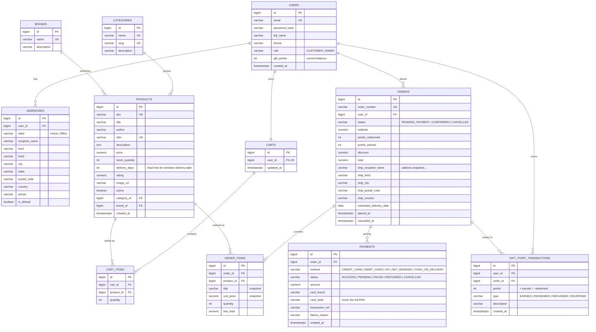

# E-Bookstore — Data Model

Derived from the capstone wireframes / customer journeys (slides 3–10).

## 1. Wireframe → entity mapping

| # | Customer journey step (wireframe) | Entities / features |
|---|-----------------------------------|---------------------|
| 1 | Login page | `User` — register, login (JWT) |
| 2 | User authentication | `User.role`, Spring Security + JWT |
| 3 | Product catalogue per category | `Product`, `Category` — paged search & filter |
| 4 | Order history + **Buy it again** | `Order`, `OrderItem` — re-add an order's items to the cart |
| 5 | Select category | `Category` |
| 6 | Browse brands | `Brand` (for books: publisher / imprint) |
| 7 | Select product, **tentative delivery date**, related products | `Product.deliveryDays` → computed `estimatedDeliveryDate`; related = same author or category |
| 8 | Add to basket | `Cart`, `CartItem` |
| — | **Recommendations** based on order history | computed from purchased categories / authors |
| 9 | Select delivery address | `Address` (address book); snapshotted onto `Order` |
| 10 | Initiate payment, **redeem gift points** | `Payment`, `GiftPointTransaction`, `User.giftPoints` |
| 11 | Payment confirmation | `Payment.status`, `Payment.transactionRef` |
| 12 | Purchase confirmation, **cancel within 48 h** | `Order.status`, `Order.placedAt`, refund + stock/points reversal |

## 2. ER diagram

## 3. Business rules

| Rule | Value / behaviour |
|------|-------------------|
| Tentative delivery date | `today + product.deliveryDays`; an order's date is the **latest** of its items |
| Related products | Same author first, then same category; excludes the product itself; active only |
| Recommendations | Products in the categories / by the authors the user has bought, excluding already-purchased; falls back to top-rated |
| Buy it again | Copies an order's still-available items into the cart (quantity capped by stock) |
| Stock | Reserved atomically (`UPDATE … WHERE stock >= qty`) when the order is placed, so concurrent checkouts can't oversell; released when the order is cancelled |
| Failed payment | Recorded with status `FAILED`; the order stays `PENDING_PAYMENT` (stock and points still reserved) so the customer can retry with another method |
| Cash on delivery | Payment `PENDING`, order `CONFIRMED`; voided (`CANCELLED`) if the order is cancelled |
| Gift points — redeem | 1 point = 1.00 currency unit off; max **50 %** of the subtotal; deducted at checkout |
| Gift points — earn | 1 point per 10.00 of the paid total, credited on successful payment |
| Payment | Simulated gateway. Cards must pass the Luhn check and must not be expired; a Luhn-valid card ending in `0002` (e.g. `4000 0000 0000 0002`) is declined, as is a UPI id ending `@fail`. Only brand and last 4 digits are stored; CVV is never persisted |
| Cancel order | Allowed within **48 h** of `placedAt` while not already cancelled. Refunds the payment, restores stock, gives back redeemed points and reverses earned points |
| Order snapshots | Item title/price and shipping address are copied onto the order so later catalogue/address edits don't change history |
